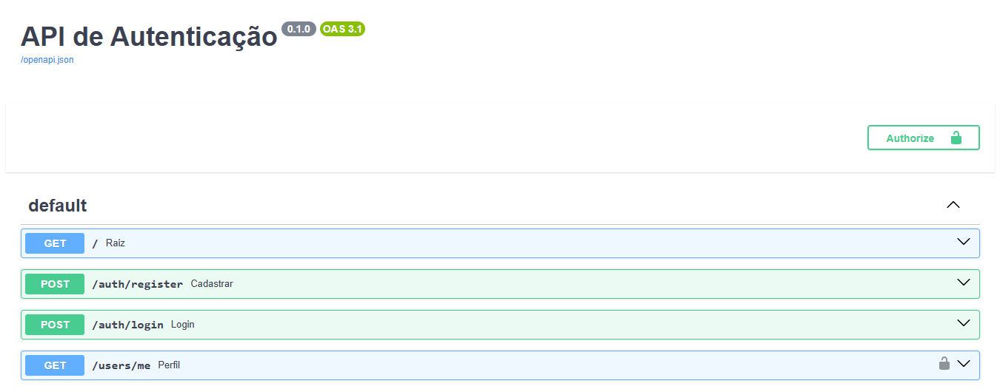

# API de Autenticação

API REST de autenticação feita com **Python** e **FastAPI**. Ela cadastra usuários, faz login e protege rotas com **token JWT**, guardando os dados em um banco **SQLite**. O projeto tem testes automatizados com **pytest**.

Projeto de portfólio, em desenvolvimento, criado para praticar back end: segurança de senhas, autenticação com token, persistência de dados e testes.

## Funcionalidades

- Cadastro de usuário com validação de e-mail
- Senhas guardadas com hash **Argon2** (a senha original nunca é salva)
- Login que devolve um token JWT com validade de 30 minutos
- Rota protegida que só responde com um token válido
- Banco de dados SQLite com SQLAlchemy (os usuários continuam salvos depois de reiniciar o servidor)
- Chave secreta lida de um arquivo `.env`, fora do código
- Testes automatizados com pytest, usando um banco separado em memória
- Documentação interativa automática (Swagger)

## Tecnologias

| Tecnologia | Uso |
|---|---|
| Python | Linguagem do projeto |
| FastAPI | Framework da API |
| Uvicorn | Servidor que roda a API |
| SQLAlchemy + SQLite | Banco de dados |
| PyJWT | Criação e validação dos tokens |
| Passlib + argon2-cffi | Hash de senhas |
| Pydantic | Validação dos dados recebidos |
| python-dotenv | Leitura das variáveis do `.env` |
| pytest + httpx | Testes automatizados |

## Como rodar o projeto

### 1. Clonar o repositório

```bash
git clone https://github.com/B0rbaa/api-de-autenticacao.git
cd api-de-autenticacao
```

### 2. Criar e ativar o ambiente virtual

```bash
python -m venv venv
```

- **Windows (PowerShell):** `venv\Scripts\activate`
- **Linux/Mac:** `source venv/bin/activate`

### 3. Instalar as dependências

```bash
pip install fastapi "uvicorn[standard]" "pydantic[email]" passlib argon2-cffi PyJWT sqlalchemy python-dotenv pytest httpx
```

### 4. Criar o arquivo `.env`

Gere uma chave secreta aleatória:

```bash
python -c "import secrets; print(secrets.token_hex(32))"
```

Crie um arquivo chamado `.env` na raiz do projeto, com o texto gerado:

```
SECRET_KEY=cole-aqui-a-chave-gerada
```

O `.env` está no `.gitignore` e não deve ser enviado ao GitHub.

### 5. Iniciar o servidor

```bash
python -m uvicorn main:app --reload
```

Abra a documentação interativa em **http://127.0.0.1:8000/docs**.

## Endpoints

| Método | Rota | Descrição | Protegida |
|---|---|---|---|
| GET | `/` | Verifica se a API está funcionando | Não |
| POST | `/auth/register` | Cadastra um novo usuário | Não |
| POST | `/auth/login` | Faz login e devolve o token JWT | Não |
| GET | `/users/me` | Devolve o e-mail do usuário logado | Sim |

### Exemplo de uso

**Cadastro** (`POST /auth/register`)

```json
{
  "email": "teste@email.com",
  "senha": "minhasenha123"
}
```

Resposta (`201`):

```json
{
  "Mensagem": "Usuário criado!"
}
```

**Login** (`POST /auth/login`), com os mesmos dados do cadastro. Resposta (`200`):

```json
{
  "access_token": "eyJhbGciOi...",
  "token_type": "bearer"
}
```

**Rota protegida** (`GET /users/me`), enviando o token no cabeçalho:

```
Authorization: Bearer eyJhbGciOi...
```

Resposta (`200`):

```json
{
  "email": "teste@email.com"
}
```

No Swagger, clique em **Authorize**, cole o `access_token` e a rota `/users/me` passa a funcionar.

### Códigos de resposta

| Código | Quando acontece |
|---|---|
| 201 | Usuário criado |
| 400 | E-mail já cadastrado |
| 401 | E-mail ou senha incorretos, token ausente, inválido ou expirado |
| 422 | Dados inválidos (por exemplo, e-mail sem `@`) |

## Testes

Os testes usam um banco SQLite em memória, separado do `usuarios.db`, então não mexem nos dados reais. Para rodar:

```bash
python -m pytest -v
```

Cenários cobertos:

- Cadastro com sucesso
- Cadastro com e-mail duplicado
- Login com sucesso (devolve o token)
- Login com senha errada
- Rota protegida sem token
- Rota protegida com token válido

## Decisões de segurança

- **Hash Argon2:** o banco guarda apenas o hash da senha.
- **Mensagem de login genérica:** o erro é sempre "E-mail ou senha incorretos", sem revelar qual dos dois está errado.
- **Token com validade:** o JWT expira em 30 minutos.
- **Segredos fora do código:** a `SECRET_KEY` vem do `.env`, e o `.gitignore` impede que `.env` e `*.db` sejam enviados ao repositório.

## Próximos passos

- [x] Cadastro e login com JWT
- [x] Rota protegida
- [x] Banco de dados SQLite
- [x] Testes automatizados com pytest
- [ ] Permissões por papel (usuário comum e admin)
- [ ] Refresh token e logout
- [ ] Limite de tentativas de login
- [ ] Migrações com Alembic
- [ ] Arquivo `requirements.txt`
- [ ] Docker e deploy

## Estrutura do projeto

```
api-de-autenticacao/
├── main.py        # API, modelos e rotas
├── test_api.py    # testes automatizados
├── .env           # chave secreta (não vai para o GitHub)
├── .gitignore
├── usuarios.db    # banco SQLite criado ao rodar (não vai para o GitHub)
└── README.md
```



## Autor

**Eduardo Borba**

- GitHub: [B0rbaa](https://github.com/B0rbaa)
- LinkedIn: [eduardoborbaa](https://www.linkedin.com/in/eduardoborbaa)